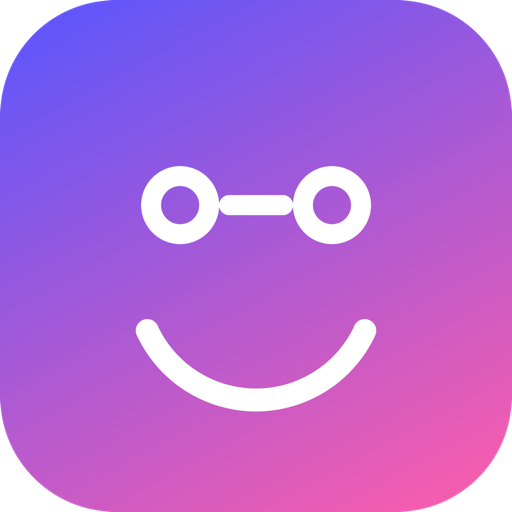
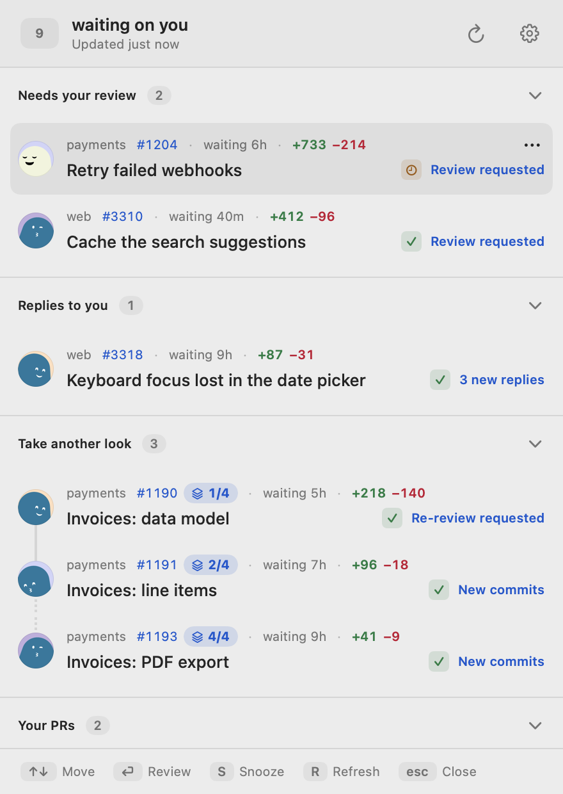
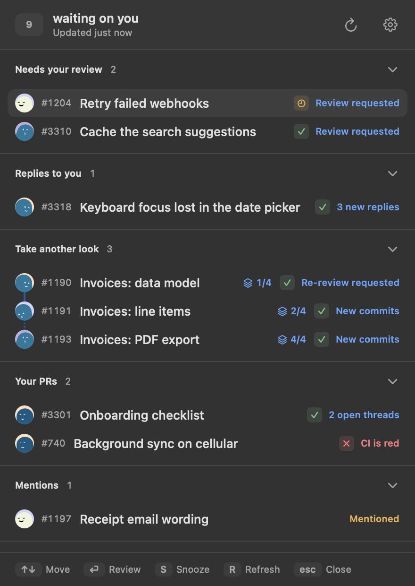

<p align="center">
  
</p>

<h1 align="center">PullJoy</h1>

<p align="center"><b>Your code-review inbox, in the macOS menu bar.</b><br />Only the pull requests that need <i>you</i>. Everything you're waiting on stays hidden.</p>

<p align="center">
  
  
</p>

---

PullJoy answers the one question GitHub notifications bury: *whose move is it?* It lists only the pull requests waiting on you, says why each one is there, keeps stacks together, and lets you snooze a pull request until new activity.

It is a native macOS app built with Apple's own tools: **Swift, SwiftUI and AppKit**, **Swift Package Manager**, and **zero third-party dependencies**. It runs on Apple Silicon with macOS 14 or later.

## ✨ Features

- 🎯 **Only what needs you.** Review requests, re-reviews, replies you owe, mentions. Each PR sits under the reason it's there, longest wait first. The ones waiting on somebody else collapse into their own section.
- 🧑‍💻 **Your own PRs, too**, when there's something for you to do: changes requested, a comment you haven't answered, red CI, merge conflicts, or approved and ready to merge.
- 🔒 **Private repos and team requests.** If an organisation restricts OAuth Apps, its pull requests are left out and a notice names it. The list stays current for every organisation PullJoy can see.
- 🧬 **Stacks stay together.** A stacked PR shows its place in the chain (`2/4`), drawn as one connected run, dotted where a member is hidden.
- 💤 **Snooze until new activity**, for 4 hours or until tomorrow, with Undo.
- 📌 **Lives in the menu bar** with a quiet count. No Dock icon.
- ⚡ **Global shortcut**, `⌃⌥P` by default, opens the inbox from anywhere.
- ⌨️ **Keyboard-driven.** `↑↓` move, `⏎` open, `S` snooze, `R` refresh, `M` menu, `esc` close.
- 🌗 **Light, dark, comfortable or compact.**
- 🚀 **Start at login**, through the system's own login items.
- 🤖 **MCP server** for Claude Code and other agents. See [MCP.md](MCP.md).
- 👀 **Read-only by design.** PullJoy never comments, approves, or merges.

## 📦 Install

The repository is private, so Homebrew needs a token:

```bash
export HOMEBREW_GITHUB_API_TOKEN=$(gh auth token)
brew tap noma4i/pulljoy https://github.com/noma4i/pulljoy
brew install --cask pulljoy
```

Releases are signed with a Developer ID and notarized by Apple.

## 🔑 Sign in

Click **Sign in with GitHub** in the popup. Your browser opens on github.com. Approve the access there, and you land back in PullJoy, signed in. No code to copy and nothing to type.

PullJoy asks for `repo` and `read:org`, the narrowest scopes that can see pull requests in private repositories and team review requests. The token is stored in your login Keychain. **Sign out** in Settings removes it.

## 🔐 Privacy

No backend, no analytics, no telemetry. The app talks to GitHub's API and nothing else. The token lives in your login Keychain. Sign-in asks for `repo` and `read:org`, the narrowest scopes that can see pull requests in private repositories and team review requests. The only thing PullJoy writes is its own settings and snooze list, on your Mac. The optional MCP server is off until you turn it on, and listens on `127.0.0.1` only.

## 🙏 Credits

The idea, the rules and the screens come from [Pullover](https://github.com/omgovich/pullover) by [Vlad Shilov](https://github.com/omgovich): the reasons, stacks, snoozes and the MCP tools are his design. The first native Swift port of it was written by [Igor Alexandrov](https://github.com/igor-alexandrov). PullJoy continues from that port.

## 📄 License

MIT. See [LICENSE](LICENSE).
